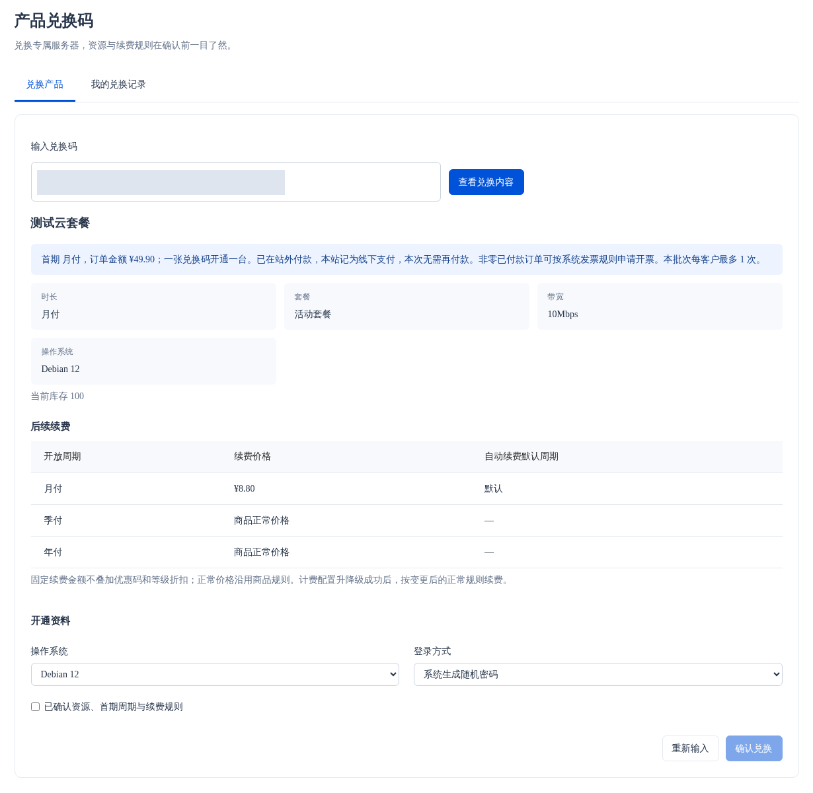
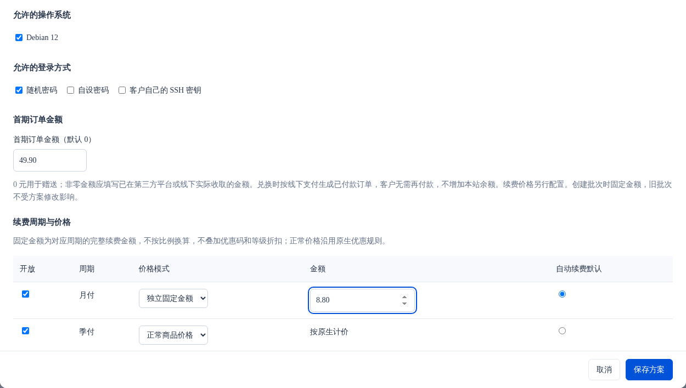
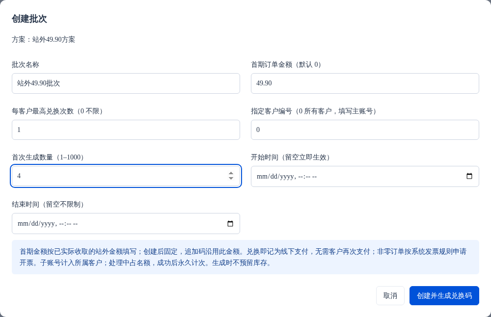
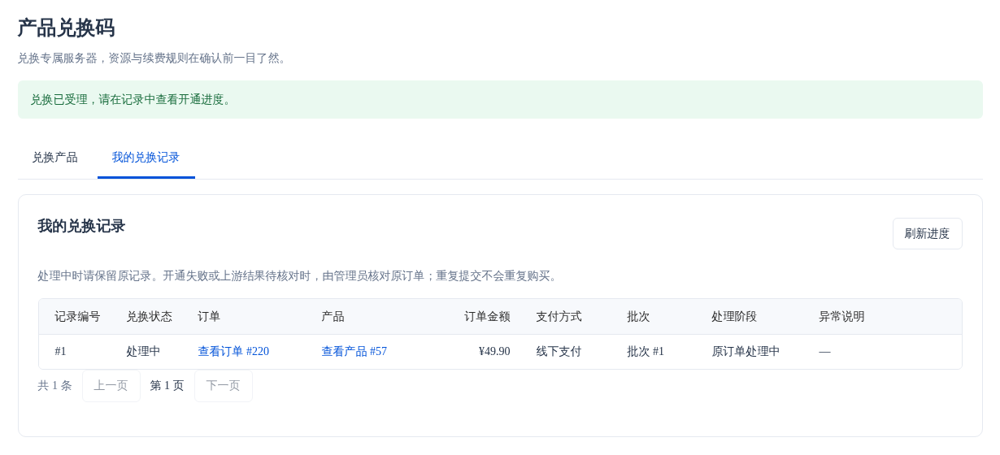

# 产品兑换码 · Cr

**让客户凭码兑换固定配置的服务器，并沿用智简魔方 V10 的订单与续费流程**

活动方案 · 批次发码 · 单码单台 · 可设置后续续费价格

 

**[使用指南](docs/使用指南.md) · [界面预览](#界面预览) · [交流与反馈](#交流与反馈)**

[功能亮点](#功能亮点) · [快速开始](#快速开始) · [适用范围](#适用范围)

## 关于产品兑换码

适合新客赠送、定向活动和站外销售。商家预先选定商品配置和首期周期，生成一批兑换码并交给目标客户。客户登录后预览资源、订单金额和续费规则，确认后使用 V10 原生服务开通流程。

## 功能亮点

- **兑换方案**在原生选配界面确定套餐或资源、首期周期和允许的开通选项，并为开放的续费周期分别定价。
- **批次发码**可设置有效期、客户范围和次数上限。生成批次时固化资源、首期金额和续费规则。
- **会员兑换**每个码使用一次并兑换一台服务器，客户可预览配置，提交后查看原生订单与产品。
- **首期金额**支持零元赠送和站外已收款的金额登记。非零金额使用 V10 线下支付网关生成已付款订单。
- **续费规则**可使用活动固定价格或正常商品价格，分别适用于已开放的续费周期。
- **运营管理**提供脱敏列表、按权限导出、暂停、作废和兑换记录。明码查看与导出单独授权并留存审计。

## 界面预览

点击查看大图。截图使用演示商品与订单，兑换码已遮盖。

| 后台设置首期与续费 | 后台创建发码批次 |
| :---: | :---: |
|  |  |
| **会员兑换预览** | **会员兑换记录** |
|  |  |

## 快速开始

1. 向开发者获取 **0.1.0 预览版**安装包，在已启用官方续费插件的 V10 站点安装。
2. 从「兑换方案」选择商品，读取原生资源配置和首期周期，再保存续费规则。
3. 创建有效期、次数和使用范围明确的批次，生成测试码，核对兑换和开通流程。
4. 在「基础设置」确认兼容检查通过后，按需开放客户新兑换。

[安装、发码与客户兑换步骤](docs/使用指南.md)

## 适用范围

当前预览覆盖已验证的魔方云、独服商品与部分代理组合。具体商品以后台兼容检查和原生选配结果为准。用于站外已收款活动时，需先启用 V10 线下支付网关。

## 交流与反馈

- **开发者 Cr** · QQ **793305720** · QQ 群 **603107399**。[加入交流群](https://qm.qq.com/q/O3d7bVtcoS)
- 反馈时请附插件版本、商品模块和操作步骤，截图中请遮盖兑换码。[提交问题](https://github.com/zbxh/cr-product-redeem-showcase/issues/new)
